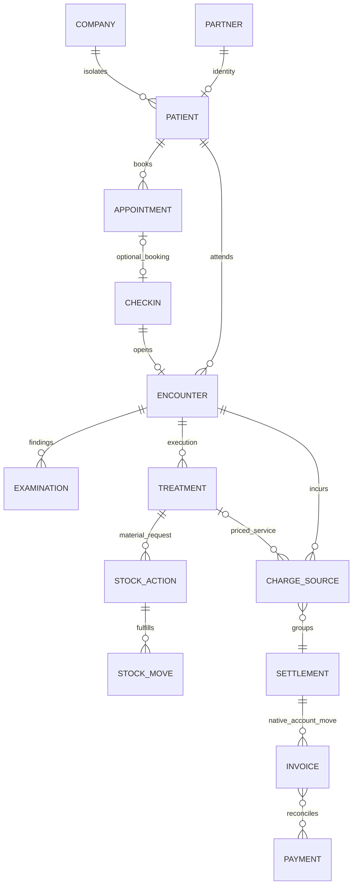

# 核心数据与权限约定

本文件是 P00 设计基线。当前代码只实现应用访问组及入口，不创建以下业务模型、六岗位权限或跨诊所业务。每项业务到所属阶段才实施并增加负向测试。

## 唯一主记录与责任边界

患者主记录选定未来的 `ydental.patient`，一对一关联 `res.partner`（联系人/付款方复用原生），医疗敏感字段保存在受限制的患者/医疗模型中，不直接暴露给通用联系人读取。唯一约束至少为 `(company_id, partner_id)`；患者查重不以手机唯一代替身份确认，合并须授权、记录旧新 ID 并保留引用。

预约主记录选定未来的 `ydental.appointment`；`calendar.event` 和可选资源预约插件只作资源/日历适配，不并行成为第二个业务预约主表。选择该自研薄层是因为已核实 OCA 20.0 暂无 resource_booking；P05 必须再次评估，若改为 OCA 主记录需在实现前修订契约并说明迁移方式，不能同时启用两个主记录。

| 对象 | 负责的事实与约束 |
| --- | --- |
| 患者 | 持久身份与医疗资料；不是一次就诊。代理付款人与患者分别引用，不改患者身份来开票。 |
| 预约 | 计划时间、工位/人员资源及改约/取消/爽约；不因预约存在就认为到诊。 |
| 报到 | 实际到达事件；可无预约，同一预约有效报到唯一；重复请求返回同一结果。未完成报到可保留事件而无就诊。 |
| 本次就诊 | `ydental.encounter`，关联患者、诊所、有效报到、实际人员/工位；各岗位看板以此 ID 协同。直接到诊先创建无预约报到。初版一次有效报到最多打开一次就诊；再次来院创建新的报到/就诊。 |
| 检查 | 发现、牙位/牙面、诊断和复核；允许诊前检查、独立检查和治疗后复核，开发顺序不限制临床顺序。 |
| 治疗 | 计划条目与实际执行分别记录；执行人、时间、牙位、签署/修订；取消计划不等同于撤销既有执行。 |
| 库存动作 | 对治疗执行发出的领用/消耗/退料请求，原生 `stock.move`/`stock.move.line` 负责实际过账、批次与数量；请求与完成状态分离。材料成本不等于收费。 |
| 费用来源 | 服务/材料等计价条目快照，关联就诊和可选治疗，保留价目、数量、税/折扣、来源版本；不可凭库存移动重复生成收费。 |
| 结算单 | 聚合有效费用来源、应收/调整及发票引用；`account.move` 与 `account.payment`/对账负责财务事实，结算看板不另维护现金账。一次费用版本只能有一个有效结算归属，冲销用新版本/贷项。 |

员工使用原生 `hr.employee`；登录账号使用 `res.users`；业务角色使用组与授权关系。员工可无账号，一人可有多个业务角色，不通过岗位文字自动获得权限。默认安排、当天排班、实际执行人分别记录，并保留替班来源。

## 角色矩阵（后续实施的默认最小授权）

所有业务权限都受允许诊所和职责范围限制。“管理”不包含删除已签署/已过账记录。平台技术管理员与诊所业务管理员分离；紧急提升权限须留痕，不以 sudo 向日常账号暴露医疗资料。

| 业务对象/操作 | 业务管理员 | 前台 | 医生 | 护士/助手 | 仓库 | 收银 |
| --- | --- | --- | --- | --- | --- | --- |
| 应用入口 | 读 | 读 | 读 | 读 | 读 | 读 |
| 员工/岗位/账号授权 | 管理，账号授权需系统管理员 | 只读必要排班资料 | 自己/工作安排 | 自己/工作安排 | 自己/工作安排 | 自己/工作安排 |
| 患者身份/联系方式 | 管理 | 建立/更正/查重 | 本诊所授权患者只读 | 分配就诊必要信息 | 无，使用匿名就诊编号 | 付款方与账务必需身份 |
| 预约/报到/工位安排 | 管理 | 创建/调整/报到 | 自己安排只读 | 分配工作只读 | 无 | 就诊和费用状态只读 |
| 病历/检查/治疗签署 | 默认无临床全文；经医疗职责另授权 | 无 | 负责就诊读写/签署/修订 | 分配就诊有限读、护理记录写；不得代签 | 无 | 仅计费代码/摘要，无病历全文 |
| 材料请求 | 异常审批 | 无 | 开立/取消未执行请求 | 授权执行/记录用量 | 接收/出入库/退料 | 仅费用相关条目 |
| 库存/成本/批次 | 管理 | 无 | 可用性，只读必要批次 | 可用性 | 管理 | 无成本访问 |
| 费用/结算/收退费 | 定价/调整/退费审批 | 只读就诊应收摘要 | 服务执行来源，不收款 | 无金额修改 | 无患者收费修改 | 结算/部分收款；退费按审批，不修改临床执行 |
| 敏感附件/审计导出 | 单独授权和留痕 | 仅身份类、职责范围 | 负责就诊医疗附件 | 分配就诊必要附件 | 仅库存单据 | 仅财务单据 |

P00 的 `ydental_base_group_user` 仅授予入口，不能解释为上述六岗位权限已经实现。普通内部用户、portal 和匿名用户不得直接访问入口。无新业务模型，因此本模块无额外 ACL 行，不改变原生数据权限。

## 公共约定

- **诊所隔离**：首版单诊所，以 `res.company` 作为诊所/核算隔离单位；未来区域/工位都带 company_id。患者和业务单据 company_id 必填；所有跨模型关系启用一致性检查，统一 `ir.access` 无组 restriction 对完整 CRUD 限制到允许 company_ids。跨店共享患者需另立授权与迁移方案，不能默认共享临床资料。
- **时区**：数据库时间存 UTC，显示依用户时区。诊所配置 IANA 时区；正式地区未定，不猜测 Asia/Shanghai。当地工作日/当天排班以诊所时区计算，夏令时歧义与跨日预约须测试。P00 环境/记录统一 UTC。
- **编号**：后续使用 `ir.sequence` 按模型/诊所区分，内部 ID 为引用主键；编号不是权限令牌，允许序列空洞，不依编号排序推断临床顺序。
- **归档**：主档使用 active；有业务引用时归档而不删。已签署医疗记录、已过账库存/财务单据禁止直接删除或篡改；修订、取消、退料、退款用关联反向事件。
- **附件**：ir.attachment 必须绑定受限业务记录，禁止 `public=True` 和任意 access_token 外链；上传/下载均验证父记录及字段权限。联系人与病历附件分开；不使用 sudo 绕过附件权限。每阶段测试不同角色/诊所下载拒绝。
- **审计**：保留 create/write 元数据；关键状态变更记录操作者、UTC 时间、前后状态、原因及来源请求。诊疗签署后生成可追溯修订，不用可编辑 chatter 作为不可篡改审计证明；敏感字段不广播给非授权关注者。审计保留期与导出权限在试运行前按地区确认。
- **重复提交/并发**：命令含公司/动作/来源级幂等键，数据库唯一约束，重试返回既有结果；预约资源冲突、重复报到、重复领料、重复计费/支付均需并发负向测试。外部回调不得仅凭前端禁用按钮防重。失败事务不留下半过账结果。
- **状态责任**：预约、报到、就诊、治疗、库存请求、财务分别维护状态，通过外键/事件连接；治疗完成不自动声称库存已扣减或已结清。公用入口不向业务用户展示底层技术或环境凭据。

## 未决事项与处理时点

| 未决项 | 影响 | 处理方案/阶段 |
| --- | --- | --- |
| 实际运营地区、诊所时区、法定留存 | 时间边界、财务本地化和审计 | P02/P04 确认时区和资料要求；P09 选财税本地化；P10 前确认试运行责任 |
| 跨店患者共享/独立核算 | 患者唯一性与隔离 | 初版按公司隔离；需求另开 Issue，不能放宽规则代替方案 |
| 资源预约 20.0 迁移 | P05 预约并发能力及工作量 | 再评估 OCA，必要时只二开适配层并重新安装/权限测试 |
| 治疗服务、材料与财务映射 | P06/P07/P09 计价、成本和结算 | 各阶段定义映射、撤销和幂等契约后实现 |
| 平台管理员紧急查阅/审计方案 | 医疗隐私与运维 | P04 明确紧急授权流程；上线前独立验收，不宣称 P00 已具备 |
