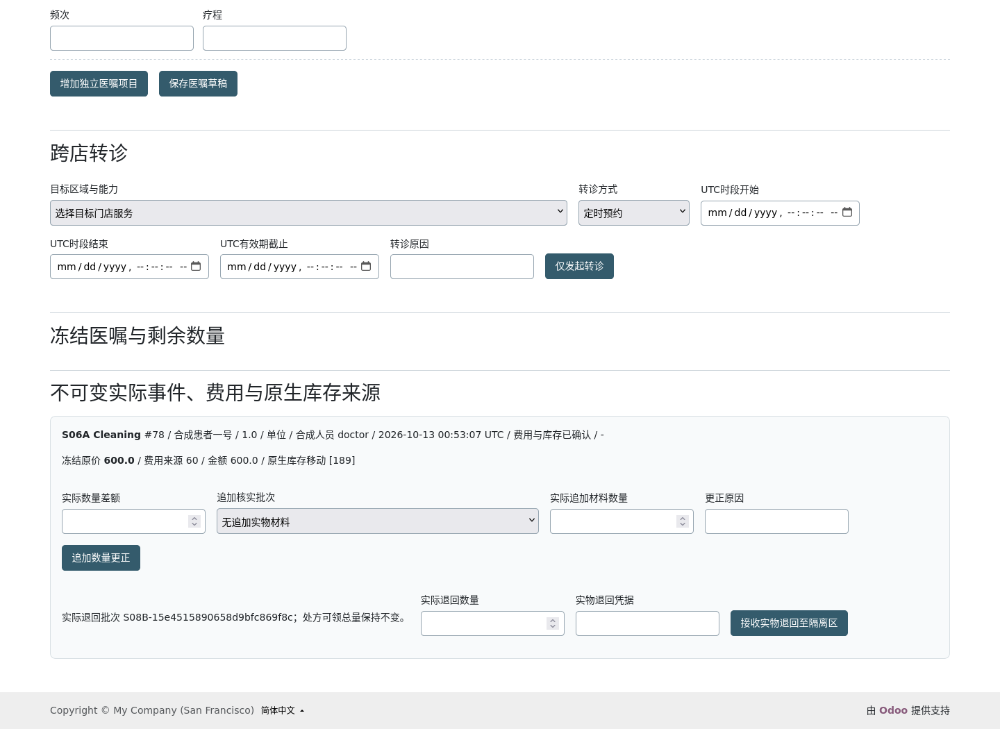
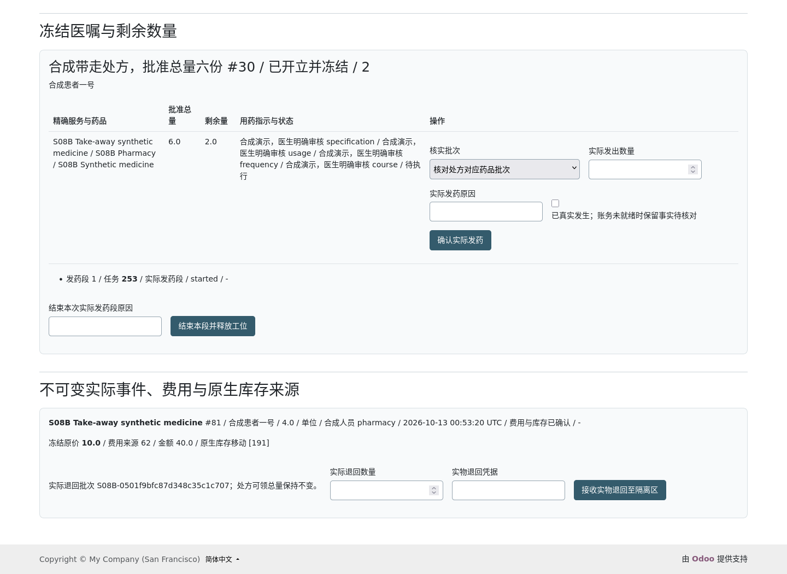
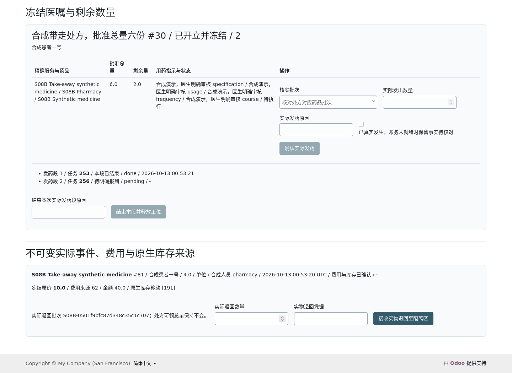
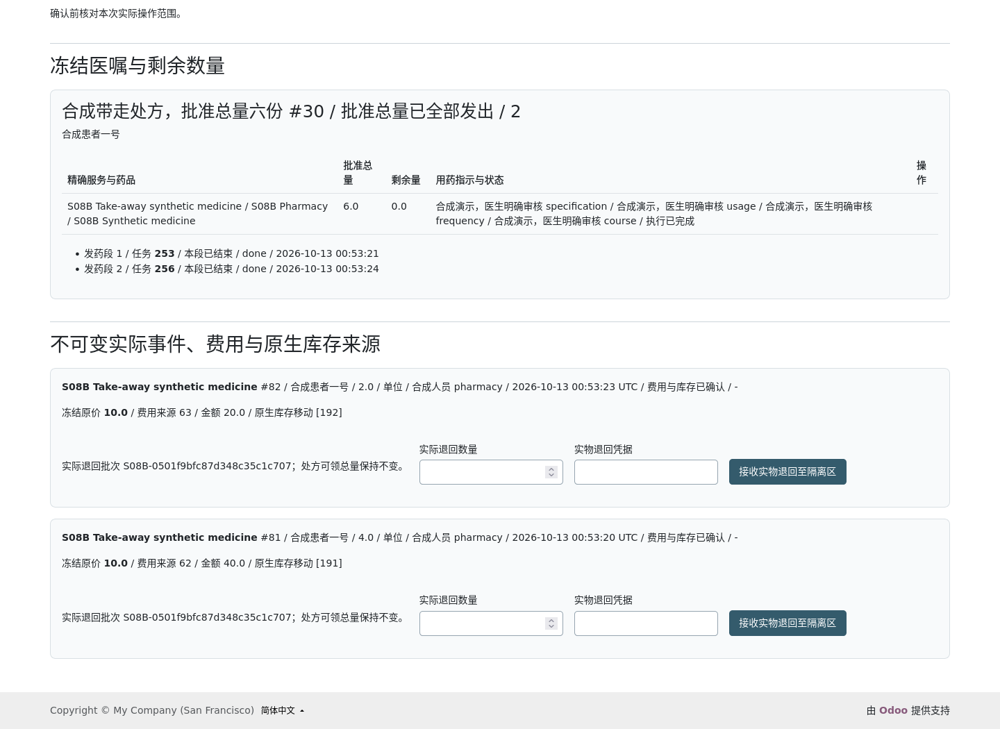
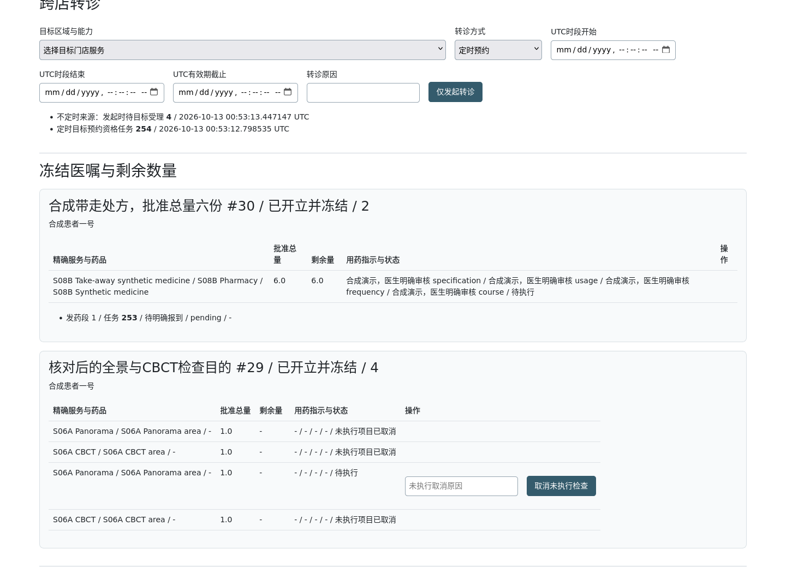
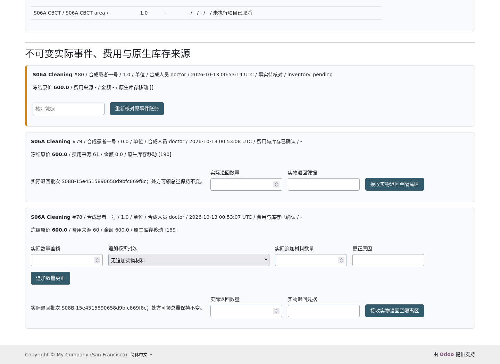

# 交付验收申请｜YD-N1 R1｜S08｜B批

任务与用户启用来源：[S08-B GPT-ACTIVATE6134476918](https://github.com/Yredxin/YDental/issues/32#issuecomment-6134476918)、[#23当前总计划](https://github.com/Yredxin/YDental/issues/23)及全部有效评论、[S08-A最终技术PASS](https://github.com/Yredxin/YDental/issues/32#issuecomment-6134425442)。开工检查已[发布并逐字读回](https://github.com/Yredxin/YDental/issues/32#issuecomment-6134535111)后实施。交付前完整重读与原有效正文/评论深比较见证据。以下全部运行结果为Codex自测，不代表GPT亲测或用户验收。

基线 `234f5bfb6b929457533286f0956924557fc68ace`；独立分支 `codex/s08-b-clinical-pharmacy-r1-20261013`；product `0b0901a2c50b95b110eb89ab792db26c91396940`；test `d976c6a1fdc7e09fb534bf5552bf4964459f3400`。final完整SHA固定于#32交付评论，避免文档自身SHA循环。product→test仅增加一个HTTP测试；test→final仅AGENTS/文档/脱敏证据。原S01—S08-A模块字节不变，所有候选提交保留。

实际环境与隔离边界：Ubuntu、Python3.12.15、固定Odoo20核心 `f0c5a9b42f544e7f18dc6c8e1c93b957837e0bcb`；PostgreSQL18.6，`odoo20-db`，127.0.0.1:5432，cluster `7694897083368259627`，既有256MiB shm/原镜像/原卷。只新增专属合成B库，记录端点/cluster/OID/marker/configSHA/data_dir/dbfilter/PID/端口。自己的libpq会话关闭并行、maintenance_work_mem16MiB；没有改Docker、核心、系统依赖、odoo-12或原有服务。最终测试库与完整命令/退出码见[固定测试清单](evidence/s08b/final-tests.json)。原108库名称/OID全部保留；未删除/重置历史库。历史S07 SIGSEGV及长期DSM增长根因仍UNKNOWN，生产继续BLOCKED。

最终全新库为`ydental_s08b_test_20261013004116_3fd605cd`，OID1239388、端口18173。固定test安装62/升级60/带committed业务升级60（49模型+11真实HTTP；安装额外2原生资产初始化），A16+B20共36组首轮独立backend/barrier、deadlock0；Firefox A88+B24共112项/34图/11真实响应屏障（A10+B1）、pageerror0，34图全部实际目视核验。中文273/273、guard5、28类SQL不变量0错误；20主表+3容量/转诊/发布价表升级签名相等，A纯文书12经济表签名相等。所有最终证据来自同一d976c6a提交、同一新库；另五个候选库及全部失败保留。

## 1. 需求完成情况

|R/功能|完成情况|实现/动作/角色|异常恢复及TC追溯|
|---|---|---|---|
|R17 文书与真实执行分离|B范围完成|clinical原模块；treatment.event/fee/consumption；execute；medical-write|文字不派生费库；缺价拒0，已发生pending；T01/T03/T04/T10/T16|
|R19 真实批次/椅旁用药|完成|InventorySource封闭适配→S07 source_action→native move/quant|原pending有据补账，真实退回quarantine；T04/T08/T09|
|R18 医嘱/检查接口|本批合同完成|order/line draft→issue冻结；cancel_exam；medical-write|未做可附原因取消，已开始拒绝；新增另单；S09实际结果NOT_RUN；T07|
|R20/F05 处方与药房|完成|prescription、segment绑定唯一S05task/S06execution；pharmacy-write|真实4+2，finish释放，余2唯一待报到；次日/closed新许可；T08/T13|
|F01 执行价/原价恢复|演示策略完成|S05发布价/native rule/实际时点快照；price.review须price-write|后来999不替代原600；未知原价须有据核价；T04/T16；生产政策待批准|
|F06/R10 定时/不定时转诊|B来源完成|ReferralSource→S05原referral；medical-write且目标法人授权|定时目标预约额，不定时到店才扣现场；无半占额；T14|
|R04/R14/R17 权限/作者责任|本批针对回归完成|S01当前门店/角色/连接；A独占/CAS/作者责任；B实际来源|旧页/跨店/RPC/context/附件/导出拒绝；多角色实际工位选择；T02/T05/T06/T09|
|F11 字典/状态/中文|完成|[合同](s08b-contracts.md)、[字段字典](s08b-data-dictionary.md)、[安全自审](s08b-security-review.md)|实际POT/PO及错误前缀校验；T12/T15|
|R24 PDF/签署/打印|未启用|S08-C|T11全部NOT_RUN|
|S09结果/S10真正出账付款/生产|未启用或BLOCKED|没有account.move过账/实收/退款接口|S09/S10 NOT_RUN；生产BLOCKED，不能把本批费用源称财务账本|

所有新持久模型只承载来源、文书外医嘱和实际分次事件。患者、库存余额、容量、叫号、实际位置、原价规则继续沿用原权威。测试模块只给新合成库S03 capacity演示前提；原A reserve/restore历史测试显式补合成外检前提，B新并发另以真实已开立处方验证reserve/restore，二者不混称。

## 2. 流程实际回放

|示例|合成前提/真实操作|实际核对与证据|
|---|---|---|
|F1|合成S05合法600版本/真实20份入库；D1三次自动保存→明确实际项目1/批次1→同source/key重试|文书保存费库0；唯一event/fee/native move；600不为0；B浏览器B00/B01、模型test_f1、B execute/source并发；最终截图索引见visual-review|
|F2|同一患者D1留全景医嘱并保存交还→D2明确报到/领取→真实项目→D1补文字|原全景仍issued未做；作者/责任链保留；补文字不再计费扣库；模型test_d1_handover_d2_real_project_d1_text_no_second_fee，A浏览器/16并发针对回归|
|F3|明确开方6→待报到→前台真实受理→药房enter/call/start→真发4→finish→新任务待报到→后来报到/叫号/start→真发2→finish|原处方累计6；两个原生issue move4/2、费源4/2；第7份拒绝；原执行completed/号位终态/lease释放，余量不自动排队；B04、B07—B11；跨日/closed/独立两药师模型与并发|
|F4|全景+CBCT草稿→显式编辑→开立冻结→原因取消未做CBCT→新增独立单|原集合不可覆盖；原取消行保留；S09真实开始fail-closed；B03、模型test_frozen_exam及test_exam_actual_start；未伪造检查结果|
|F5|当前真实医生来源→定时目标有效slot/预约池→不定时明确UTC有效期→目标后来合法受理；另核对已发生缺料|定时占一次目标预约额，接受不再扣；不定时创建不扣、接受才扣现场；到期/停接/跨法人无权失败无半来源；原600缺料事件经原S07pending有据恢复；B05/B06及真实模型/容量竞争|

B浏览器真实拦住一次已提交execute响应，再强制更改原页字段，验证请求期间冻结、完整参数变化保留原页、同源核对入口且无自动重放。A十次真实响应屏障继续验证confirm/correct/handover终态保护与普通autosave追赶。没有将前台排队、开方、文字确认或合成S09结果当实际治疗/发药。

药房终止状态：`原处方issued → segment1待报到 → S06waiting/calling/serving → 实发4 → 原execution/entry completed、task done、append ended、lease退出 → segment2唯一待报到(余2) → 新报到/叫号/start → 实发2 → completed、原处方done`。结束为B上层封闭S06扩展，不是牙科handover、不新造门诊资格；原actor/station/time与历史保留。

## 3. 测试结果

最终完整机器可读结果、每次命令/退出码/logSHA、固定提交和证据路径见[final-tests.json](evidence/s08b/final-tests.json)。原始日志/配置/凭据留本机私有目录；仓库保留脱敏摘要、真实失败栈、探针JSON和合成截图。之前候选的成功不拼为最终PASS。

|TC|结果/实际断言|角色/运行入口|
|---|---|---|
|T01|PASS：三次草稿/自动保存及A终态回归费库守恒|doctor；A模型/Firefox；纯文书经济签名|
|T02|PASS：双编辑/CAS乱序/失效连接，首轮双backend竞争|doctor1/2；A16并发/Firefox|
|T03|PASS：项目/source/key幂等、两事务事件费库唯一|medical-write；B20并发及真实HTTP|
|T04|PASS：未做不足回滚；已发生pending/原600恢复、缺价人工有据核价；native完成后异常无半账|medical/warehouse/price各自岗位；B模型/并发|
|T05|PASS：保留/交还同事务，失败不半交还、后继唯一、释放编辑|A模型/并发/Firefox|
|T06|PASS：同患者D1→D2真实项目→D1补文书；责任/原医嘱保留、不重费库|两medical-write；B模型、A责任链针对回归|
|T07|PASS：draft编辑保留旧行、issue集合冻结、取消未做/新增另单；目标S09开始拒绝|medical-write；B模型/并发/Firefox；S09结果NOT_RUN|
|T08|PASS：真实4+2、重复/第7份拒、真实椅旁药无重复处方、退回不恢复可领|pharmacy-write/medical-write；B模型/HTTP/Firefox|
|T09-A/B|PASS：当前门店/撤权/跨法人/旧页/伪context/直接RPC/附件/导出拒绝；药房单权合法派生|doctor/pharmacist/reader/none/front；真实HTTP/并发|
|T10-A/B|PASS：文字版本费库不变；数量/材料差额追加及原价关联、实退quarantine|medical/pharmacy；B模型/A浏览器；S10已出账更正NOT_RUN|
|T11|NOT_RUN：PDF/签署/打印全留S08-C|未启用|
|T12-B|PASS：最终固定提交新库安装、升级、带已提交业务再升级、原模块字节与依赖方向、真实HTTP/中文/SQL|专属runner；完整数量/退出码见final-tests|
|T13|PASS：统一药房队列、finish历史终态/释放、唯一余量、新日/closed新许可、两真实药师竞争|front/pharmacy-write；B模型20并发/Firefox|
|T14-A/B|PASS：后继原方向不复制外检、B真实source定时/不定时转诊及容量/权限/失败回滚|medical/source/targetfront；A16+B20并发/B模型/Firefox|
|T15|PASS：A52恒乳牙/牙面/缺失未知/0不适用，B显式牙位状态；非法值拒绝|A/B模型/Firefox；正式字段/签发仍待审核|
|T16-A/B|PASS：分动作审计、原价格/费库存快照、受控核价/恢复/退回；纯文字不改经济|SQL审计/升级签名；打印NOT_RUN|

最终安装额外2项为Odoo原生资产初始化，不冒称JS单元测试。独立PostgreSQL竞争首轮两PID和真实barrier均记录，serialization按有界策略重试；不以末次池PID是否相同判竞争。A历史原失败内层frame仍UNKNOWN，本批不声称恢复历史frame。

## 4. 字段、动作与配置

完整字段/关系/单位/选项/必填/默认/未知值见[数据字典](s08b-data-dictionary.md)；十二动作参数、角色、状态、副作用、稳定错误、审计、事务恢复及经济矩阵见[合同](s08b-contracts.md)。

采用演示策略`demo_confirmation`，S05发布目录/native价规则为唯一取价来源，执行时原UTC/本店日期冻结。600/10/后来999均合成测试价格，不是生产批准价。医生输入实际UTC秒值只能在原serving段起点至当前时间；留空采用本次明确确认时间。字段不默认医学剂量或结论。未安装S09真实结果/设备、S10财务、S08-C PDF；生产审核/药物政策/税币种/性能阈值未批准。

多角色账号按当前真实执行段/持有工位选择医疗或药房视图；price入口独立显式授权。读权限只能看当前门店相应来源，所有写再次后台校验。缺价待核对由price-write独立有据核原价后，原执行者reconcile；仓库仅按S07证据恢复原pendingmove，不能新造治疗。

## 5. 用户效果验证

只在专属合成库按角色演示，入口`/ydental/access`选当前合成门店，不在GitHub放账号口令。每一步预期以最终截图/数据库记录为准。

1. 合格医生进入`/ydental/queue`坐诊、叫号、开始，再到原`/ydental/clinical`保存三次；确认文书版本递增且费库无变化。
2. 从临床导航进入`/ydental/treatment`，核对患者/执行段/已保存版本、项目、牙位状态、数量及实际批次；明确确认已做，核对唯一600费源及native move。
3. 创建全景+CBCT检查草稿，编辑后开立；原集合冻结，附原因取消未做CBCT，保留全景；不显示假检查结果。
4. 输入真实medicine关联的合成处方六单位及规格/用法/频次/疗程，开立；任务为待报到，尚未扣库/计费。
5. 医生独立走原A保存交还并退出；前台对患者/指定处方任务明确报到。药房人员到合格工位enter/call/start。
6. 药房核对药品批次和余量，明确实发4；核对move/费源数量4。点击结束本次段，确认lease释放、原段completed、同处方唯一余2待报到。
7. 后来前台重新报到该余量任务，药房重新叫号/start并实发2；核对累计6/余0。发第7份拒绝，保留核对页；原处方仍无超发。
8. 医生从真实来源选择定时目标slot或不定时UTC有效期发起转诊；核对目标预约/现场占额时点，原接诊不会自动交还。
9. 明确已发生缺料事件显示pending；真实仓库有据入库后恢复原S07event、原医生核对B事件。后来价格不覆盖原600；普通新缺料执行拒绝。
10. 只读角色查看同页并尝试受控动作，服务器拒绝；D1补文字不追加费用/耗材。响应不明时留原页、另页核对，禁止自动重放。

下图是最终固定test的实际Firefox截图；完整34张及SHA/逐张核验见[visual-review.json](evidence/s08b/visual-review.json)。患者、人员、药品与医疗内容全部合成；原生move和费用源ID另由[只读SQL投影](evidence/s08b/committed-business-projection.json)核对。

## 6. 数据、审计与回滚

最终SQL不变量及20表升级签名、纯文书经济签名见final-tests及audit-attempts。检查涵盖A版本/后继/患者唯一、原生quant与done move流量守恒、S07原pending证据/原move与唯一来源、B fee/event/stock状态矩阵、原时间/价/责任/批次、处方累计/余量唯一/历史completed、outbox对应原生bus一次且最小payload。财务表未安装时明确NOT_INSTALLED，不冒称已完成收款测试。

最终committed数据含17个B事件、15个费用来源（2个有意保留的待核对事实，无假费用）、37个S07库存事件。28类SQL全0；额外容量slot、转诊及发布价三表、容量计数升级前后相等。F3原处方30、任务253/256，真实发药事件81/82、费用62/63金额40/20、native move191/192数量4/2，两原执行/entry均completed、task done、lease inactive。F1事件78/费用60金额600/native move189数量1；材料差额事件79追加move190但数量差额0，原记录保留。这些是最终浏览器实际committed记录，不用回滚模型夹具冒充。

失败过程全部保留，见[尝试与失败清单](evidence/s08b/attempt-history.json)。包含初始ORM保留方法名冲突、附件阻断tuple、真实取消/S05夹具、午夜时区/仓库唯一、测试断言范围、日期发布前提、HTML选择器/字段秒精度/双角色界面、实际POT漏UTC等失败及修正。一次Firefox page crash根因UNKNOWN，原JSON/frame保留；当时专属Odoo仍存活、PG OOM=false，后续新浏览器通过不等于根因修复。无本批Odoo SIGSEGV；历史S07风险继续存在。

Project全量开工/交付双读回21字段、15条目、6视图及其字段、7公开workflow深比较一致，本批0 mutation。#32保持S08/进行中/Todo/OPEN，#31待用户验收，后续待启用。未关闭、合并、强推或自动启用后续。

回退先禁用B入口或仅停匹配configSHA/PID的本批预览，保留全部数据库、filestore、日志、Git提交及截图。含completed历史的B库不可直接用A源码升级/卸载B；后续升级/迁移需保留来源及历史，不通过删库恢复。生产回滚/部署未执行。

## 7. 复核申请

仅申请GPT对固定B product/test/final与上述证据进行独立技术复核。所有PASS均为Codex自测；用户最终统一验收尚未执行。正式用药/字段/签发/取价政策及S08-C/S09/S10未授权部分不能算完成。

## 8. 交付与停止

独立B分支正常推送，远端SHA/产品树读回；#32发布`[CODEX] S08-B交付验收申请`并逐字读回后停止。final完整SHA/最终评论URL在GitHub交付固定。无Project mutation、Issue关闭、主分支合并、强推、生产部署或自动启用C/S09。
